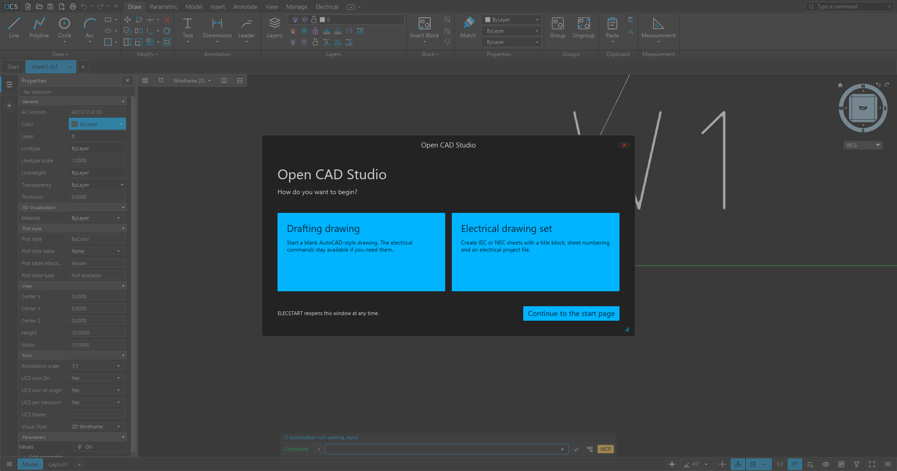
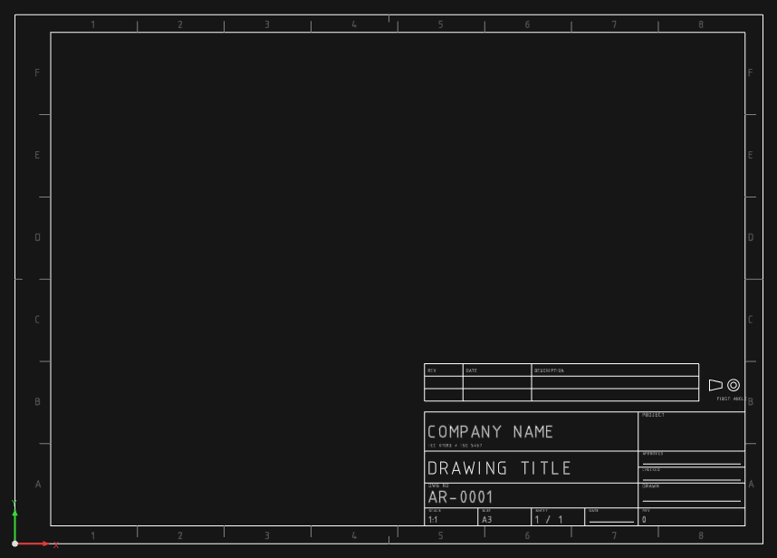

# OpenCADElectrical

**Open-source electrical CAD for schematics, panel layouts and drawing sets.**
Working name — the repository rename follows when permitted.

OpenCADElectrical is a fork of [Open CAD Studio](https://github.com/HakanSeven12/OpenCADStudio),
the cross-platform DWG/DXF editor written in Rust, with an electrical layer built on top of
it. It aims at the workflow AutoCAD Electrical users expect — project drawing sets, IEC and
NEC title-block sheets, a symbol library with real pins, wire and net management, device
tagging, bills of material, cables and panel layouts — while remaining a native drawing
editor that reads and writes ordinary DWG and DXF files.

> **Status: work in progress.** The base editor is mature; the electrical layer is under
> active development. Do not make it the only record of a production drawing yet. The
> current limits are listed at the end of the [quick start](docs/QUICKSTART.md#10-honest-limits).



## What the electrical layer adds

- **A drawing set, not a blank drawing.** On launch the application asks whether you want a
  normal drafting drawing or an electrical drawing set, then builds the set from a standard
  template: standard, size, project fields, sheet count and folder.
- **Real sheets.** Fifteen templates: IEC A4–A0 and B1 (ISO 5457 frame, first-angle title
  block) and NEC ANSI A–E plus Legal (ASME Y14.1 frame, third-angle title block), each with
  zone references, a revision table and a title block that is filled from the project data.
- **Symbols with pins.** A local symbol library with previews, insert-and-place and
  automatic tagging. Symbols carry their pin attributes, so connectivity resolves to a
  device pin (`-K1:2`) instead of only "the wire touches the block".
- **Wires, nets and junctions.** Drawn conductors become a netlist; junction dots and
  terminal bridges are honoured; wire numbers and labels are generated from the sheet.
- **Documentation output.** Component list, terminal list, wire list, a bill of material
  that can be filtered by option code, an Excel workbook, and a panel layout generated from
  the schematic.
- **Cables.** A drawn cable route becomes a schedule row with a measured length and both
  ends resolved to device pins.
- **PLC and I/O.** PLC modules with addresses, project-wide address continuation, and
  import of an I/O list.
- **Reuse and variants.** Reusable starter circuits, variant sheet sets and option codes for
  optional equipment.
- **Automation.** The electrical command set is available headless, through the MCP bridge
  (including a dedicated `electrical` read operation and the `cad://guides/ecad` guide), and
  through a node-graph **Electrical** category that evaluates nets, pins and components.



## Built on Open CAD Studio

This project would not exist without **Open CAD Studio**, created and maintained by
**HakanSeven12 and the Open CAD Studio contributors**. The drawing kernel, DWG/DXF codec,
rendering, blocks and attributes, layers, printing, plugin system and MCP server are their
work, and they released it under the GNU GPL so that projects like this one are possible.

Thank you. If OpenCADElectrical is useful to you, please also support the upstream project:

- Open CAD Studio: <https://github.com/HakanSeven12/OpenCADStudio>
- Web application: <https://www.opencadstudio.com>
- Discussions: <https://github.com/HakanSeven12/OpenCADStudio/discussions>

This repository is an independent fork, not an official Open CAD Studio release, and the
upstream maintainers are not responsible for the electrical additions or for this fork's
bugs. Full attribution and licence notes are in [docs/CREDITS.md](docs/CREDITS.md). The
upstream project's translations of its own README remain under `docs/readme/`.

OpenCADElectrical is inspired by the workflow of AutoCAD Electrical but is an independent
implementation; it contains no Autodesk code, symbols or data. AutoCAD and AutoCAD
Electrical are trademarks of Autodesk, Inc.

## Naming

The documentation calls the product **OpenCADElectrical** while the rename is pending. The
repository, the executable (`OpenCADStudio.exe`) and the portable folder
(`dist/AryaCADElectrical-portable`) keep their current names until the rename is permitted.
Historical engineering reports under `reports/` keep the names used at the time.

## Build and run

Desktop builds target Windows first; the upstream application also builds for Linux, macOS
and the web. A Rust toolchain is required.

```powershell
cargo build --release
target\release\OpenCADStudio.exe
```

Or build the self-contained portable folder:

```powershell
powershell -File packaging\portable.ps1
dist\AryaCADElectrical-portable\OpenCADStudio.exe
```

Then follow the [quick start](docs/QUICKSTART.md): create a drawing set, load a symbol
library, place devices, draw conductors, number them and produce the reports.

A finished example is in [`samples/demo-line`](samples/demo-line/README.md) — open
`project.eprj` or `sheet1.dxf` and run `ELECLIST`, `ELECWIRELIST`, `ELECCABLELIST` and
`ELECPANEL` to see the outputs.

## Documentation

| Document | Contents |
|---|---|
| [docs/README.md](docs/README.md) | documentation index and feature overview |
| [docs/QUICKSTART.md](docs/QUICKSTART.md) | build, first schematic, reports, cables, panels, projects, automation |
| [docs/commands-reference.md](docs/commands-reference.md) | command reference (`ELECHELP` lists the electrical set in the app) |
| [docs/automation/guides/ecad.md](docs/automation/guides/ecad.md) | the ECAD workflow in order, plus the checks that tell you a drawing is right |
| [docs/automation/README.md](docs/automation/README.md) | driving the editor over MCP |
| [templates/README.md](templates/README.md) | the IEC and NEC templates |
| [reports/PROGRESS.md](reports/PROGRESS.md) | dated engineering log of the electrical build-out |
| [docs/CREDITS.md](docs/CREDITS.md) | upstream credits, third-party projects and licence notes |

## Tests

```powershell
cargo test --release --lib
py -3.13 tests\ecad\run_smoke.py --baseline target\release\OpenCADStudio.exe --current target\release\OpenCADStudio.exe --no-real-sheets
py -3.13 tests\ecad\verify_mcp_ecad.py
```

The MCP check expects an editor already running with `--automation`; it is the end-to-end
proof for the electrical read operation and the node-graph Electrical category.

## License

GNU General Public License v3.0 — see [LICENSE](LICENSE). The upstream Open CAD Studio code
remains copyright its authors; the electrical additions in this repository are distributed
under the same licence. The software is provided without warranty; keep backups of
important drawings.
