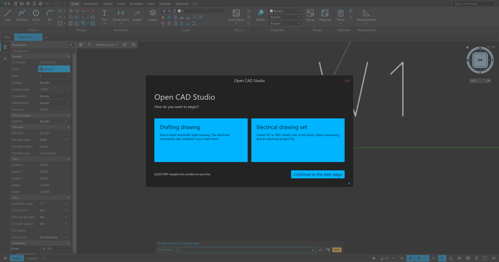
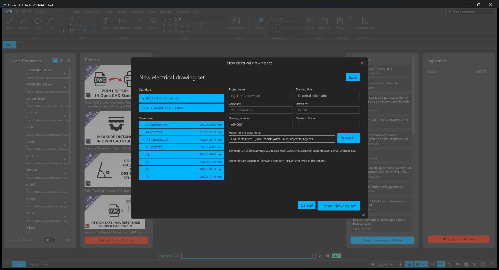
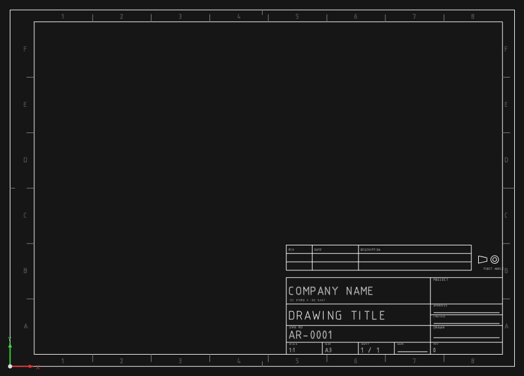
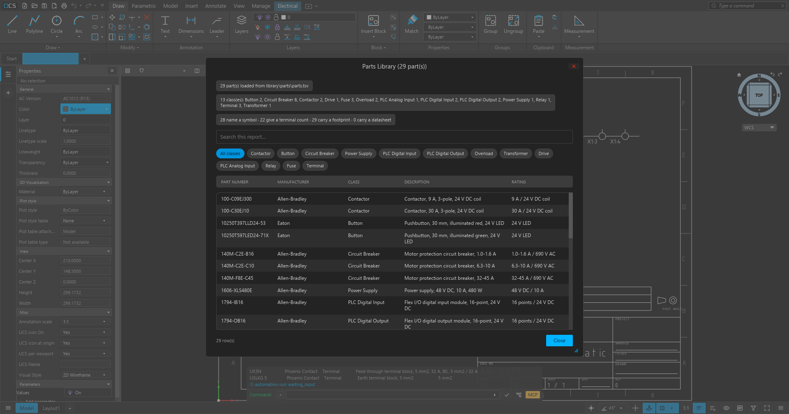
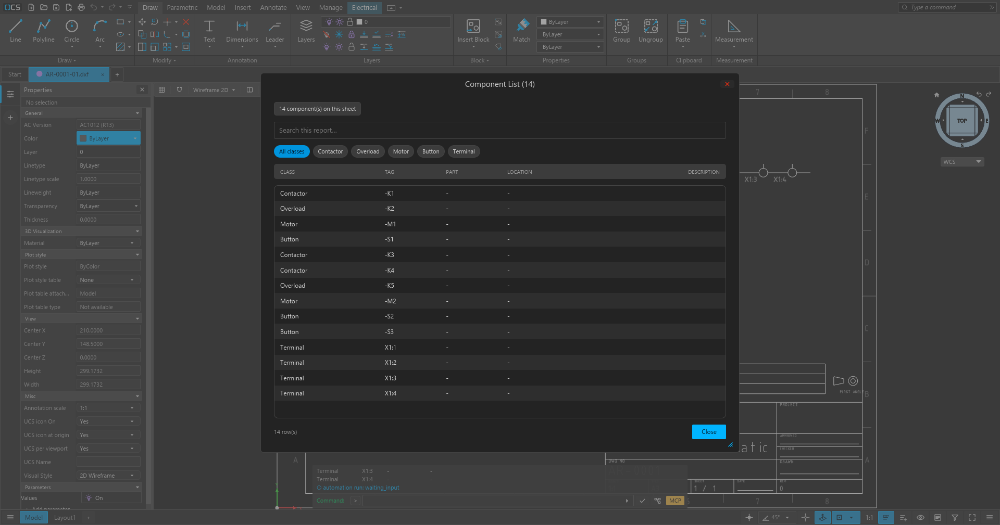
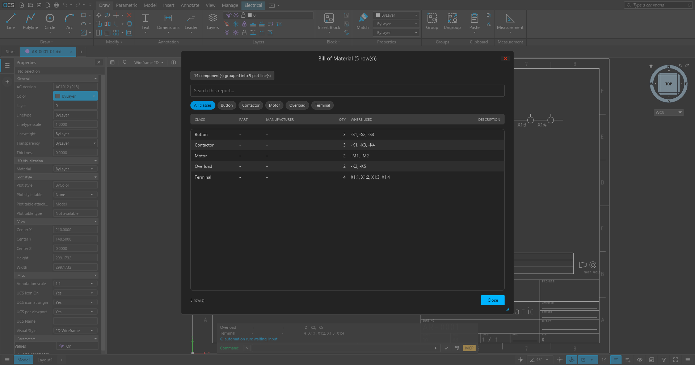

# Quick start — OpenCADElectrical

OpenCADElectrical (working name) is the Open CAD Studio editor with an electrical layer on
top. The electrical layer lives in the same `OpenCADStudio.exe`: an **Electrical** ribbon
tab and a set of `ELEC…` commands that also work from the command line and from headless
batches. Everything is local and file-based; no account, no online catalogue.

The base editor is the work of the Open CAD Studio project — see
[CREDITS.md](CREDITS.md) and the upstream repository at
<https://github.com/HakanSeven12/OpenCADStudio>. This fork is a work in progress, not an
official Open CAD Studio release.



## 1. Run it

Build from source (see `reports/HANDOFF.md` for the full build notes):

```powershell
$env:PATH="$env:USERPROFILE\.cargo\bin;$env:PATH"
cargo build --release -j 4
target\release\OpenCADStudio.exe
```

or use the portable folder produced by `packaging/portable.ps1` (the folder keeps its
current name until the repository rename):

```powershell
powershell -File packaging\portable.ps1
dist\AryaCADElectrical-portable\OpenCADStudio.exe
```

A sample project is in `samples\demo-line\`: open `project.eprj` (or the drawings directly),
run `ELECLIST`, `ELECWIRELIST`, `ELECCABLELIST` and `ELECPANEL` to see the finished outputs.

On launch the suite asks how you want to begin: **Drafting drawing** (plain CAD) or
**Electrical drawing set**. The electrical path is a small setup panel: standard (IEC or
NEC), sheet size, project/title/company/drawing number, drawn-by, number of sheets and the
output folder. **Browse…** opens the Windows folder picker, so the location is chosen rather
than typed. **Create** makes the sheet set from the bundled templates, fills the title
block, writes the project file and opens the first sheet. If Windows protects the chosen
folder, the set is written to a writable fallback (the app's per-user folder, then temp) and
the command line says where it went; `ELECSTART` reopens that chooser.



Each sheet is a real drawing with a standard frame, zone references, revision table and a
filled title block; the same template outside a project looks like this:



## 2. First schematic

| step | command |
|---|---|
| start from a standard sheet | `ELECNEW templates\iec\A3_landscape.dxf` (IEC A4–A0 and B1, NEC ANSI A–E plus Legal; see `templates\README.md`) |
| new drawing, electrical layers | `ELECNEW` |
| load the symbol library | `ELECLIB library\starter` (or `library` for the harvested set) |
| browse/place symbols | `ELECPALETTE`, or `ELECINSERT CONTACT_NO` |
| draw conductors | `ELECWIRE`, click the points, Enter to finish |
| junction dots | `ELECJUNCTIONS` |
| list the devices | `ELECLIST` |
| number devices | `ELECNUMBER` (preview) / `ELECNUMBER apply` |
| wire numbers and labels | `ELECWIRENUMBER`, then `ELECWIRELABELS labels.csv` |

Every symbol carries real pins: the local library writes `X*TERM*` attributes at the pin
positions, so `ELECWIRELIST` names the device pin at each end of a conductor
(`net 1 -> -K1:2, -K2:1`) and `ELECWIRELIST wirelist.csv` exports
`Wire, Net, From pin, To pin, From X, From Y, To X, To Y`.

## 3. Parts, BOM and reports

| step | command |
|---|---|
| load the local parts catalogue | `ELECPARTS library\parts` |
| search / attach a part | `ELECPARTLIST fuse`, `ELECASSIGN -K1 LPJ-100SP` |
| bill of material | `ELECBOM bom.csv` |
| full workbook (BOM, wire list, terminals, cables) | `ELECREPORT report.xlsx` |

The ribbon buttons for **Parts Library**, **Component List**, **Terminal Strips**,
**Bill of Material** and **Wire List** open a searchable report dialog — the same tables
shown here. Every row can be filtered by class (or by strip) and by free text, and the same
lines still print to the command line for scripts.

| Parts library | Component list |
|---|---|
|  |  |



## 4. PLC and I/O

`ELECPLC -P1 8 I0.0` builds a PLC module with `ADDRnn` attributes; `ELECPLCNEXT` continues
the address sequence across the project; `ELECIO` lists the device each point reaches.

`ELECIOIMPORT iolist.xlsx` generates the PLC modules from a controls engineer's I/O sheet
(tolerant header matching; one card per address prefix).

## 5. Cables

A cable is a drawn object, and the schedule is measured from it:

1. `ELECCABLEDRAW W1 CORES=3 SHIELD=yes PART=LIYCY-3X1.5 DESC=Motor feeder`
2. click the route, Enter to finish — the route lands on `CABLES`, the tag beside it, and a
   shield bracket when `SHIELD=yes`.
3. `ELECCABLELIST cables.csv` prints/export the schedule: measured length and both ends
   resolved to device pins (`W1, Motor feeder, LIYCY-3X1.5, -, 43.83, 3, yes, -K1:2, -K2:1`).

`ELECCABLE` adds a schedule-only cable when there is nothing to draw.

## 6. Panel layout

1. put devices on the schematic first (the panel is generated from them);
2. `ELECPANEL panel.dxf` — places rail devices on 35 mm DIN rails, plate devices on plate
   rows and door devices on the door with round cut-outs, sizes the enclosure and registers
   the drawing in the project file. Footprints are editable in
   `library\panel\footprints.tsv` (a project can override them with `footprints.tsv`).

## 7. Projects, revisions, systems, variants

| step | command |
|---|---|
| build a project from a folder of drawings | `ELECPROJNEW C:\Projects\Line` |
| list the project's sheets | `ELECPROJLIST` |
| renumber across the project | `ELECPROJNUM` (preview) / `ELECPROJNUM apply` — honours `WD_M` `TAGMODE=R` |
| revision snapshots | `ELECREV SNAPSHOT label`, `ELECREV LIST`, `ELECREV RESTORE id` |
| built/assembled protection | `ELECBUILT ON` / `ELECBUILT OFF` |
| reusable sub-circuits | `ELECSYSTEM LIST`, `ELECSYSTEM INSERT DOL_STARTER 0,0`, `ELECSYSTEM SAVE my_starter` |
| alternative sheet sets | `ELECVARIANT NEW pumpset_b`, `ELECVARIANT LIST`, `ELECVARIANT USE pumpset_b` |
| option codes | `ELECOPTION -K1 pump-set-B`, `ELECOPTION LIST` |

`ELECHELP` prints every electrical command grouped the way the ribbon is organised.

## 8. Drawings from AutoCAD Electrical

`ELECSETUP` prints the drawing's own `WD_M` contract (`TAGFMT`, `TAGMODE`, `WIREFMT`).
When `TAGMODE=R` the references on that sheet are fixed: `ELECNUMBER` and `ELECPROJNUM`
leave them alone. The customer prints that were exploded (symbols flattened to text) still
yield their device tags from the text; nets only reach devices where the symbols survived.

## 9. Headless use (scripting and tests)

```powershell
target\release\OpenCADStudio.exe --each batch.txt drawing.dxf
```

One command per line, a blank line ends an interactive command, point input is `x,y`, and
the drawing is only written when the batch ends with `SAVE`/`QSAVE`. Every example in this
document works that way; `reports/HANDOFF.md` lists the batches used for verification.

### MCP automation

The editor can be driven over MCP by another agent or a script. Start it with the bridge
already on (the same thing the MCP chip in the status bar toggles), then point an MCP client
at the stdio server:

```powershell
target\release\OpenCADStudio.exe --automation samples\demo-line\sheet1.dxf
target\release\OpenCADStudio.exe --mcp      # a second process speaks MCP on stdin/stdout
```

The electrical sheet is readable through the `electrical` operation (nets, pins, loose pins,
wire length and components — the same wire graph the `ELEC…` commands use, with
`detail:"summary"` for counts only). An ECAD skill/guide is served as `cad://guides/ecad`
and by the `guide` operation; the node graph exposes an **Electrical** category
(`Electrical Netlist`, `Electrical Wire Length`, `Electrical Components`, `Net At Point`)
for visual wiring and batch evaluation. `tests\ecad\verify_mcp_ecad.py` is the end-to-end
check for this surface (it expects an editor already running with `--automation`).

## 10. Custom blocks, symbols and modules

Two kinds of reusable content exist, and they share the same block machinery:

| what | commands |
|---|---|
| generic CAD blocks (furniture, title blocks, anything) | `BLOCK` (or `BMAKE`) · `WBLOCK` / `WB` · `-BLOCK`, `-WBLOCK` for scripts · `BLOCKPALETTE` · the Block Editor for dynamic blocks with grips |
| electrical symbols and device modules | `ELECMAKESYMBOL` · `ELECLIB` · the **Insert Symbol** palette · `ELECPLACE` |

A device module is a block whose attribute definitions are also its connection data:

1. Draw the body on the drawing at the size you want it placed (mm on IEC/NEC sheets).
2. Put an attribute definition where each wire connects — `ATTDEF`, tag `X1TERM01`,
   `X1TERM02`, … on the right edge and `X4TERM01`, `X4TERM02`, … on the left, the way
   AutoCAD Electrical stores pins. Mark them **invisible**: a pin is data, not text.
3. Select the geometry and the pin attributes, then run
   `ELECMAKESYMBOL IO16 CLASS=IO_Module PINS=8`.
   `PINS=n` is optional: it adds `n` pins total — the odd one on the right edge
   (`X1TERMnn`) and the rest on the left (`X2TERMnn`) — evenly spaced and invisible.
   `CLASS=` groups the symbol in the palette and in the reports (one token, e.g. `CLASS=Drive`).
4. The command defines the block in the drawing, writes `IO16.dxf` into the loaded
   library folder and appends its row to that folder's `library.tsv`:
   `symbol <TAB> class <TAB> attributes|tags <TAB> scale`. Set `scale` to `25.4` for a
   symbol drawn at the starter library's ~1-unit size, or `1` for a symbol drawn in mm.
   The same command works for VFDs, network switches, HMIs, remote I/O, safety relays and
   any other class — the only difference is the body drawing and the number of pins.
5. Reuse it anywhere: `ELECLIB library\starter` loads every symbol in the folder into the
   drawing, the **Insert Symbol** palette lists it by class, and `ELECPLACE IO16` places it
   with every pin attribute sitting exactly on the point the symbol author drew. Wires
   ending there join the net, so `ELECWIRELIST`, `ELECTERMINALS`, `ELECBOM` and the
   `electrical` MCP read see the pins immediately.
6. Share the library by keeping the folder — any drawing can `ELECLIB` it, and a project
   can carry its own `library.tsv` and DXFs beside the drawings.

The starter library ships 30 symbols, including `PLC-DI`, `PLC-DO`, `VFD`,
`NETWORK_SWITCH`, `HMI` and `IO_MODULE`; they are generated by
`py -3.13 tools\make_library.py` from the `SYMBOLS` table, so adding a class to the shipped
library is one entry there plus a rerun. `ELECMAKESYMBOL` is the route for one-off symbols
and customer-specific modules.

## 11. Honest limits

Panels need part-level footprint overrides and a separate door elevation; a drawn cable is
one bundle (its cores are not separate nets yet); cross-reference labels are text, not
clickable links; variants select sheets but reports do not filter by them yet; and the
build/test gates are manual (`cargo check --release --tests`, `cargo test -p elec --lib`).
