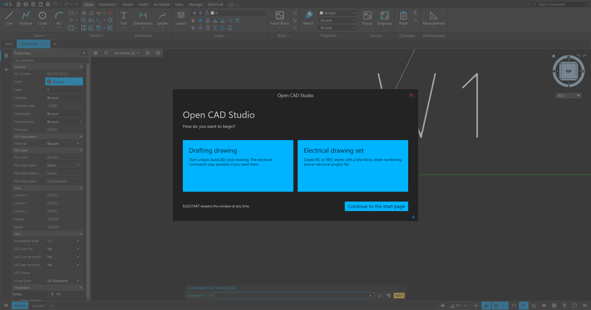
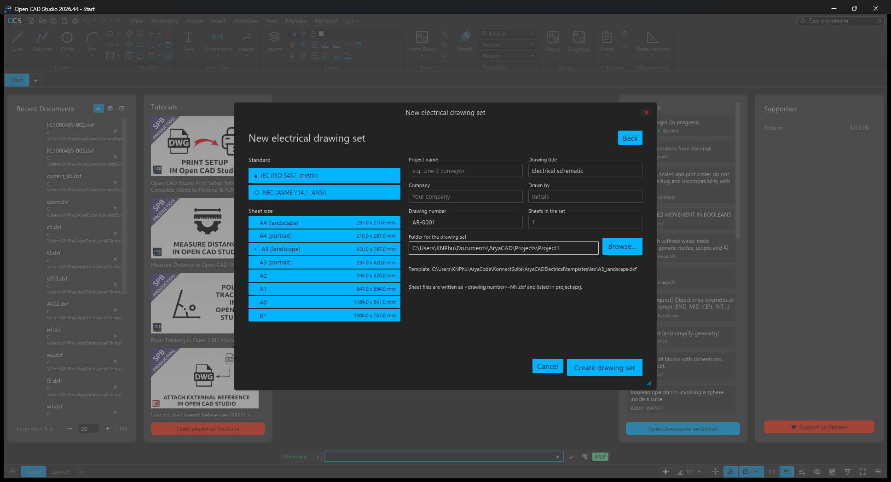
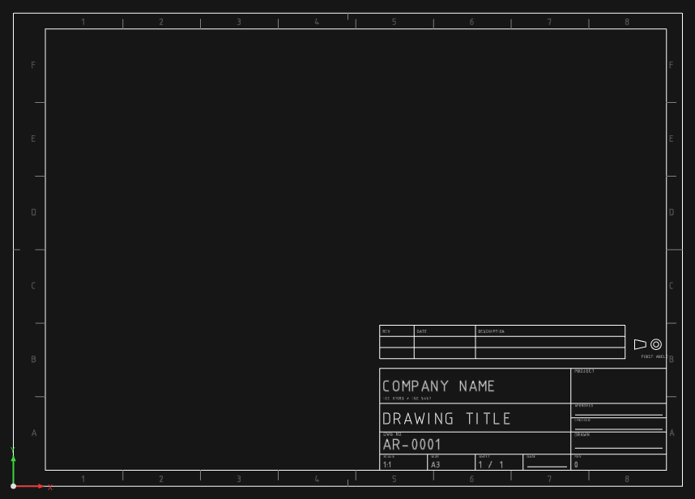
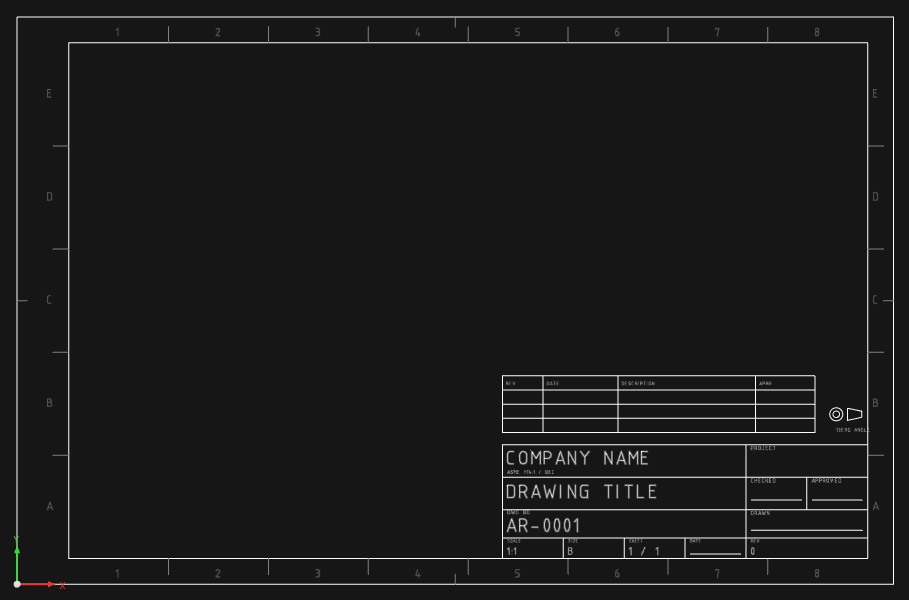
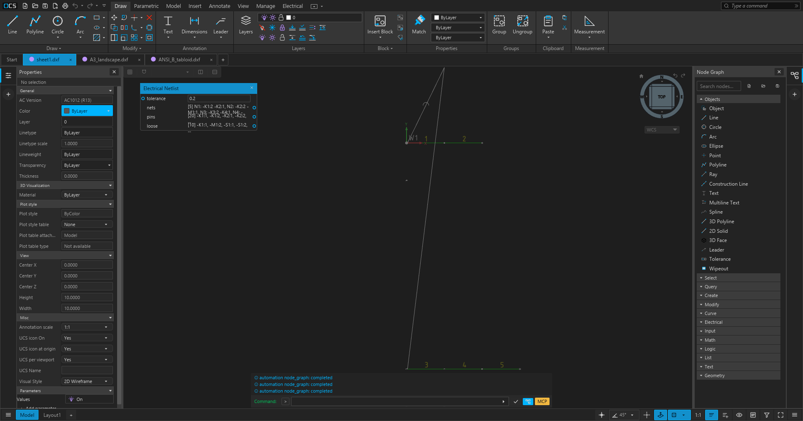
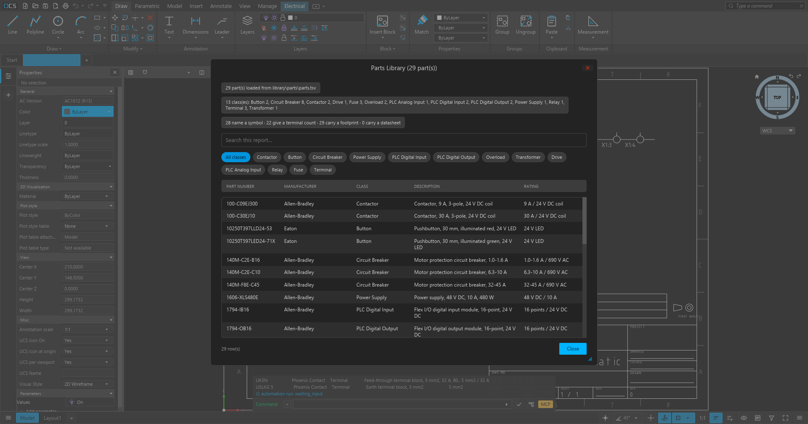
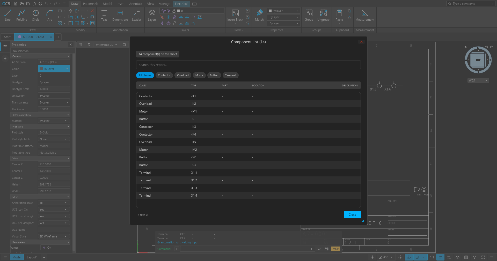
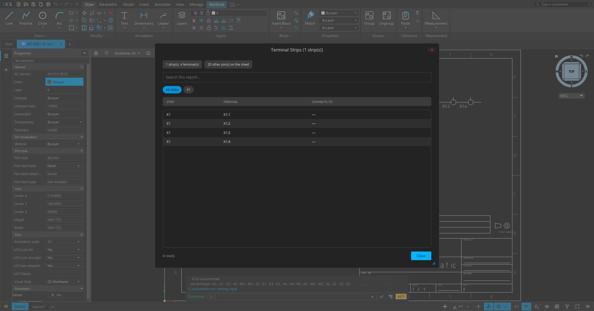
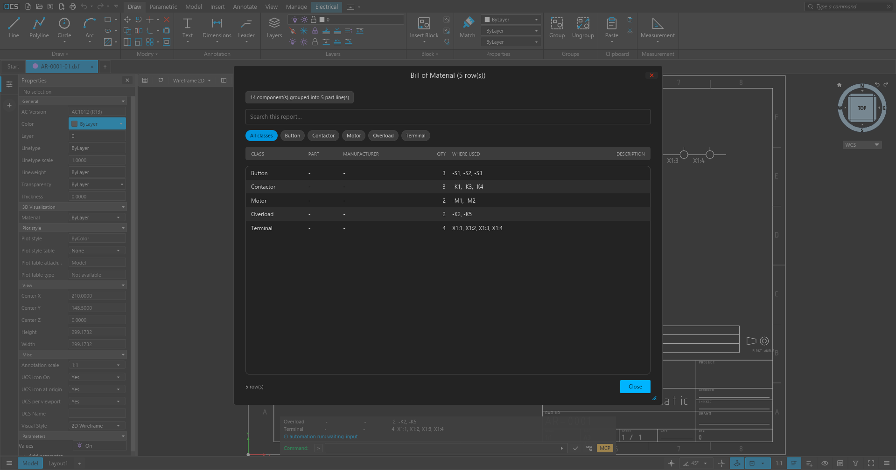
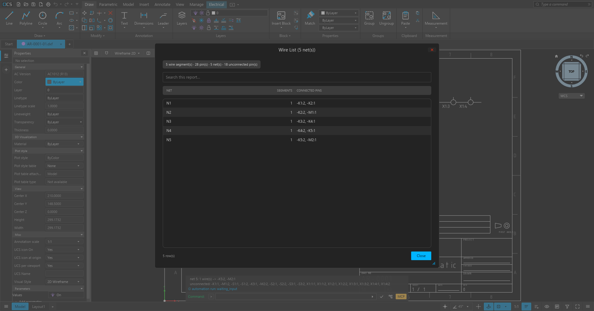

# OpenCADElectrical documentation

OpenCADElectrical (working name) is an open-source electrical CAD application for
schematics, panel layouts and drawing sets. It is a fork of **Open CAD Studio**, the
cross-platform DWG/DXF editor, with an electrical layer added on top: project drawing sets,
IEC and NEC sheet templates, a symbol library with real pins, wire and net management,
numbering, bills of material, cables and reports.

The project is a **work in progress**. The base editor is mature; the electrical layer is
under active development and should not yet be the only record of a production drawing.
`docs/QUICKSTART.md` ends with the honest list of current limits.

The CAD engine, file formats, rendering, plugin system and MCP server come from Open CAD
Studio. Please read [CREDITS.md](CREDITS.md) for the upstream project, its authors and the
licence terms; this fork is not an official Open CAD Studio release.

## What it looks like

| First launch | Electrical drawing-set wizard |
|---|---|
|  |  |

| IEC A3 sheet | NEC ANSI B sheet |
|---|---|
|  |  |

The node graph's **Electrical** category evaluates the same netlist the commands use:

## Electrical panels and reports

Every report button on the **Electrical** ribbon opens a real dialog instead of writing to
the command line: a summary strip, a search field, one filter chip per class or strip, and
a themed table. The command line still receives the same text, so scripts keep working.

| Parts library | Component list |
|---|---|
|  |  |

| Terminal strips | Bill of material |
|---|---|
|  |  |

## Start here

| I want to… | Read |
|---|---|
| install/build and draw a first schematic | [QUICKSTART.md](QUICKSTART.md) |
| look up an electrical command | [commands-reference.md](commands-reference.md) and `ELECHELP` in the app |
| understand the ECAD workflow in order | [automation/guides/ecad.md](automation/guides/ecad.md) |
| drive the editor from an agent or script | [automation/README.md](automation/README.md) |
| use or regenerate the sheet templates | [../templates/README.md](../templates/README.md) |
| open a finished example | [../samples/demo-line/README.md](../samples/demo-line/README.md) |
| see what was done and when | [../reports/PROGRESS.md](../reports/PROGRESS.md) |
| check the upstream credits | [CREDITS.md](CREDITS.md) |

## The electrical layer at a glance

- **Drawing sets** — the app asks whether you want a normal drafting drawing or an
  electrical drawing set. The wizard chooses IEC/ISO or NEC/ASME, a sheet size, the project
  fields and the folder, then writes the sheet set from the bundled templates with the
  title block filled and a `project.eprj` file beside the drawings.
- **Templates** — fifteen ready-to-use sheets: IEC A4–A0 and B1, NEC ANSI A–E and Legal,
  each with a frame, zone references, revision table, projection symbol and a real title
  block.
- **Symbols and devices** — a local symbol library (`library/starter`, `library`) with
  preview, insert-and-place and automatic tagging. Symbols carry pin attributes so
  connectivity reaches `-K1:2` level, not just "this wire touches that block".
- **Wiring** — drawn conductors become a netlist with junctions and terminal bridges;
  device pins are labelled, wires can be numbered, and unconnected pins are reported.
- **Documentation output** — component and terminal lists, a bill of material that can be
  filtered by option code, wire lists, a multi-sheet Excel workbook, and a panel layout
  generated from the schematic.
- **Cables** — a drawn cable route becomes a schedule row with measured length and both
  ends resolved to device pins.
- **PLC and I/O** — PLC modules with addresses, project-wide address continuation, and
  import of a controls engineer's I/O list.
- **Reuse** — reusable systems (starter circuits) saved from and inserted into drawings,
  variant sheet sets, and option codes for optional equipment.
- **Automation** — every electrical command is available headless, over the MCP bridge, and
  through a node-graph Electrical category that evaluates nets, pins and components.

## Naming and history

The documentation calls the product **OpenCADElectrical** for now. The repository, the
executable and the portable folder still carry their current names until a rename is
permitted (`OpenCADStudio.exe`, `dist/AryaCADElectrical-portable`). Historical reports in
`reports/` keep the earlier names on purpose; see [CREDITS.md](CREDITS.md#documentation-conventions).

## Status

| area | state |
|---|---|
| base CAD editor, DWG/DXF, printing, plugins, MCP | from upstream, working |
| drawing-set wizard and templates | working, verified |
| symbols, wiring, netlist, numbering | working, verified |
| BOM, wire list, terminal list, Excel report | working, verified |
| cables, PLC I/O, panel layout | working, with the limits listed in the quick start |
| MCP `electrical` operation and ECAD guide | working, verified end to end |

Tests and checks: `cargo test --release --lib`, `tests/ecad/run_smoke.py` and
`tests/ecad/verify_mcp_ecad.py`. The smoke suite covers the electrical commands on the
bundled sample and, when the original customer sheets are present, on those too.
